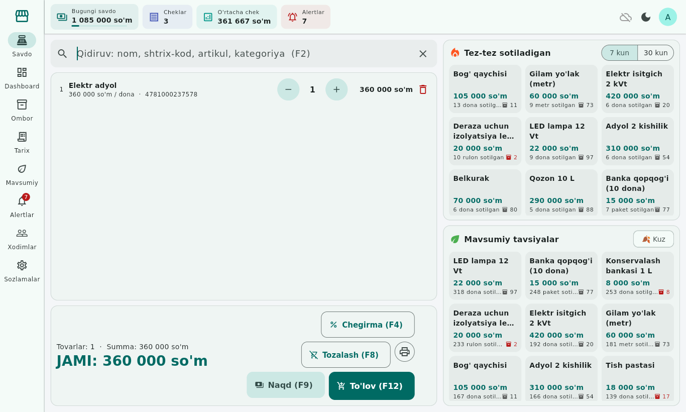
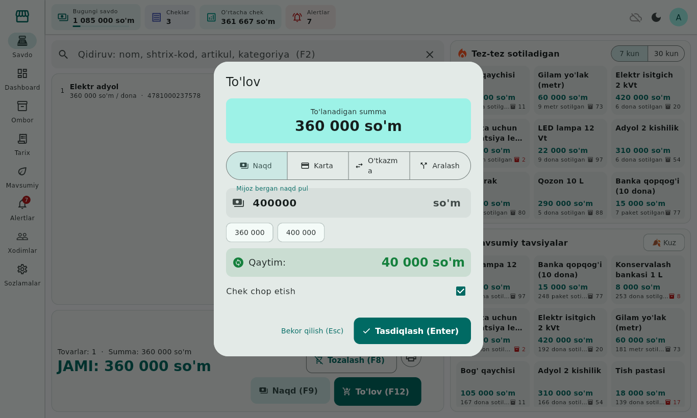
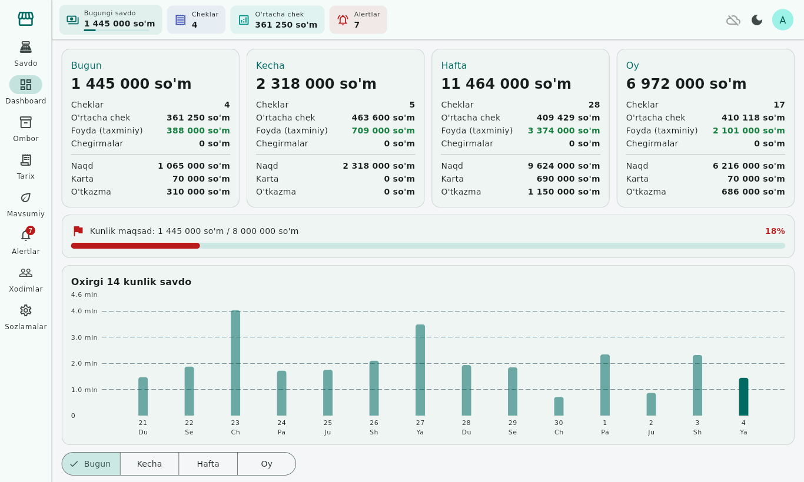
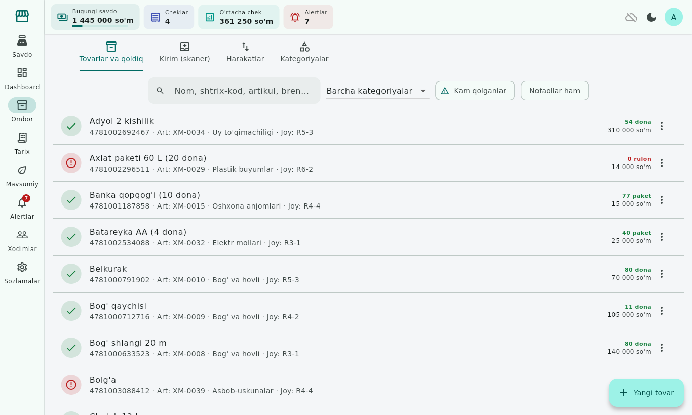
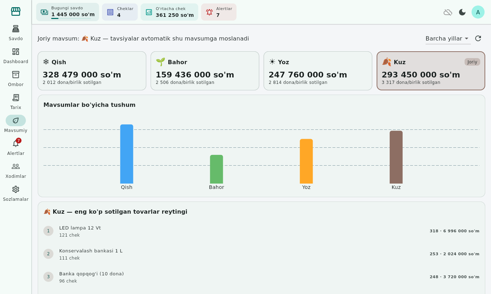
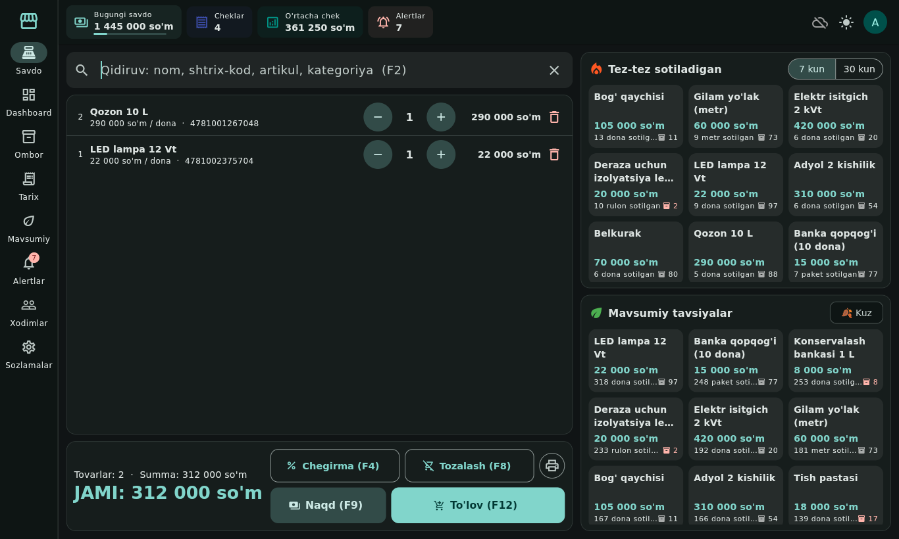
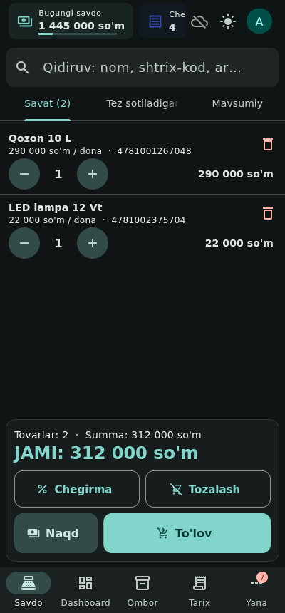

# POS Terminal — xo'jalik mollari do'koni uchun kassa tizimi

Offline-first POS tizimi: bitta Flutter kod bazasidan **Windows, macOS, Linux, Android, iOS**.
Har bir qurilma internetsiz to'liq ishlaydi; bir nechta qurilma ixtiyoriy server orqali
avtomatik sinxronlanadi (notebook o'chiq bo'lsa ham telefon savdo qilaveradi).



## Imkoniyatlar

- **Kassa:** nom / shtrix-kod / artikul / kategoriya bo'yicha tez qidiruv, savat, chegirma
  (% yoki summa; kassir 20% gacha, undan ko'pi admin tasdig'i bilan), naqd / karta / o'tkazma /
  aralash to'lov, qaytim, chek chop etish. F2, F4, F8, F9, F12 tezkor tugmalari.
- **O'ng panel:** "Tez-tez sotiladigan" (7/30 kun, real vaqtda) va "Mavsumiy tavsiyalar"
  (joriy mavsum avtomatik aniqlanadi).
- **Dashboard:** bugun / kecha / hafta / oy, o'rtacha chek, foyda, top tovarlar, kassirlar
  bo'yicha savdo, kunlik maqsad, real-time qoldiq.
- **Mavsumiy tahlil:** qish / bahor / yoz / kuz uchun alohida reyting.
- **Alertlar:** kam qoldiq, tovar tugadi, kunlik maqsad bajarilmadi, anomal (juda katta) chek —
  dashboardda va tizim bildirishnomasida.
- **Ombor:** real-time qoldiq, skaner bilan kirim, hisobdan chiqarish, qaytarishlar,
  minimal qoldiq, 30+ standart tovar atributi (MXIK, QQS, brend, o'lcham, mavsum ...).
- **Savdo tarixi:** sana, kassir, to'lov turi, summa bo'yicha filtr; chekni ko'rish, qayta chop etish, qaytarish.
- **Rollar:** Admin, Kassir, Omborchi.
- **Uskunalar:** 2 ta ESC/POS termoprinter (USB, Bluetooth, Wi-Fi/LAN; 58/80 mm),
  2 ta shtrix-kod skaneri (USB/Bluetooth HID) + telefon kamerasi.
- **Yorug' va qorong'u rejim**, to'liq o'zbek tilida (lotin).

## Tuzilma

| Papka | Tarkibi |
|---|---|
| [`app/`](app/) | Flutter ilova (Riverpod + Drift/SQLite) |
| [`server/`](server/) | Ixtiyoriy sinxronlash serveri (FastAPI + PostgreSQL, Docker) |
| [`docs/ORNATISH_QOLLANMASI.md`](docs/ORNATISH_QOLLANMASI.md) | **O'rnatish qo'llanmasi** (barcha platformalar, server, printer, skaner) |
| [`docs/ARXITEKTURA.md`](docs/ARXITEKTURA.md) | Arxitektura, 12 bosqich, baza sxemasi, sinxronlash qoidalari |
| [`.github/workflows/build.yml`](.github/workflows/build.yml) | Barcha platformalar uchun avtomatik build |

## Tez boshlash

```bash
cd app
flutter pub get
flutter run -d windows      # yoki macos / linux / <telefon>
```
Birinchi kirish: **admin / admin123** (kirgandan keyin parolni o'zgartiring).
Sinab ko'rish uchun: Sozlamalar → Ma'lumotlar → Demo ma'lumotlarni yuklash.

Server (ixtiyoriy):
```bash
cd server && cp .env.example .env && docker compose up -d
```

## Skrinshotlar

| | |
|---|---|
|  |  |
|  |  |
|  |  |

Versiya: 1.0.0
